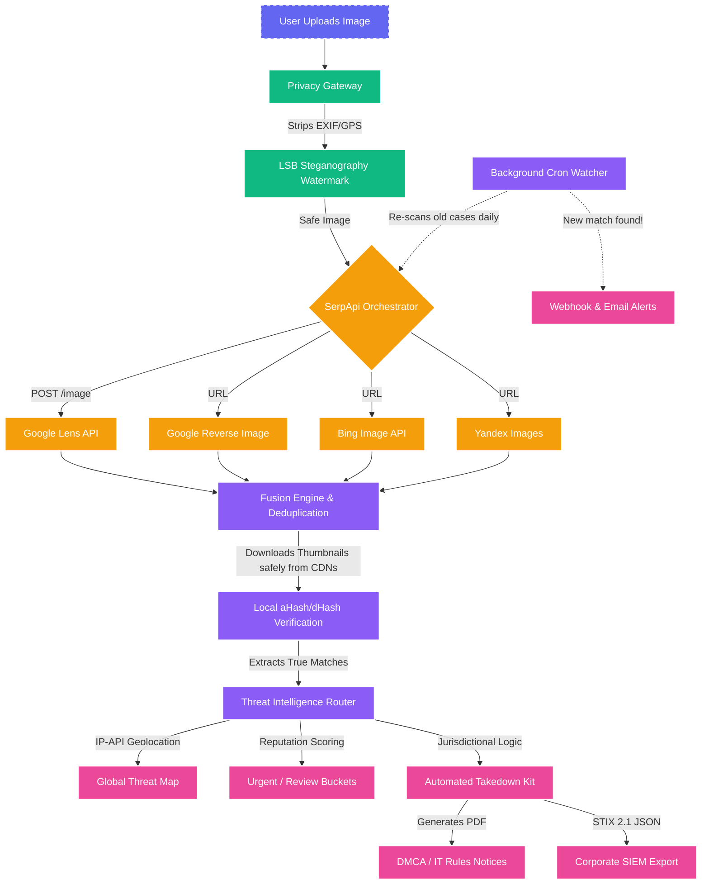

<div align="center">
  
  <h1>🪞 Aaina: Enterprise Threat Intelligence</h1>
  <p><b>Find where your photos are being misused online, understand the risk, and automate the takedown process.</b></p>
  
  [](https://www.python.org/)
  [](https://fastapi.tiangolo.com/)
  [](https://streamlit.io/)
  [](https://serpapi.com/)
  [](LICENSE)
</div>

---

## 📖 What is Aaina?

**Aaina** is a privacy-first, enterprise-grade reverse-image search and threat intelligence platform. It was built specifically to help individuals and security teams track down deepfakes, impersonation profiles, and non-consensual image sharing across the internet.

Unlike traditional reverse-image search tools that sell your data, Aaina strips your image of metadata, searches across 4 different search engines simultaneously (bypassing CAPTCHAs using **SerpApi**), deduplicates the results, and prepares legally binding DMCA/IT-Rules takedown notices.

---

## 🏗️ System Architecture

Aaina's architecture is uniquely designed for **OPSEC (Operational Security)** and zero-trust privacy. It processes sensitive logic locally, preventing malicious websites from tracking the user's IP address.



### 🧠 How the Architecture Works:
1. **Privacy Gateway:** Uploaded images are stripped of GPS/EXIF data. Users can opt to inject a cryptographic LSB invisible watermark into their photo before sharing it online.
2. **SerpApi Orchestrator:** The sanitized image is fired via multi-threading to 4 search engines at once (Google Lens, Google Reverse, Bing, Yandex).
3. **Local Hashing Verification:** To prevent SSRF attacks or IP-logging from malicious sites, Aaina **never** visits the suspect websites directly. It downloads thumbnails safely from Google/Bing CDNs and runs perceptual hashing (dHash/aHash) on the server to verify matches.
4. **Threat Intelligence:** Offending domains are geolocated and mapped. Takedown PDFs are generated based on the server's jurisdiction (e.g., DMCA for US, IT Rules 2021 for India, GDPR for EU).

---

## ✨ Core Features

* **🌍 4-Engine Fusion:** Merges results from Google Lens, Google Reverse Image, Bing, and Yandex to ensure zero blind spots.
* **🔒 Cloud Storage Sync:** Supports stateless Google Cloud Run deployment by syncing the SQLite Auth Database to Google Cloud Storage.
* **🎥 Deepfake Video Scanner:** Automatically parses `.mp4` and `.mov` files, extracts keyframes using OpenCV, and reverse-searches the frames.
* **⚖️ AI Legal Assistant:** Includes an NLP-powered chatbot to guide victims through filing cybercrime complaints and understanding jurisdictional laws.
* **📄 Automated Takedown Kits:** Instantly generates fill-in-the-blank PDF legal notices tailored to the exact IP address hosting the stolen image.
* **🛡️ STIX 2.1 Exports:** Security teams can download the entire case file in SIEM-compatible STIX 2.1 format for enterprise ingestion.
* **🔔 Continuous Watcher:** A headless CLI tool that runs on a cronjob, constantly re-scanning old cases and sending Webhook/Email alerts if a photo pops up on a new website weeks later.

---

## 🛠️ Tech Stack

* **Frontend:** Streamlit, Custom Glassmorphism CSS, PyDeck (Geospatial Mapping)
* **Backend:** Python 3.11, FastAPI (for headless integration)
* **Database:** SQLite3 backed by Google Cloud Storage (GCS)
* **Image Processing:** OpenCV (Video parsing), Pillow (EXIF stripping & perceptual hashing)
* **API Providers:** SerpApi (Search Engines), IP-API (Geolocation)
* **DevOps:** Docker, Google Cloud Run

---

## 🚀 Getting Started

### 1. Prerequisites
You will need a [SerpApi Account](https://serpapi.com/) for the search engine queries.

### 2. Local Setup
```bash
git clone https://github.com/YOUR_USERNAME/Aaina.git
cd Aaina

# Create virtual environment
python -m venv venv
venv\Scripts\activate  # Windows
# source venv/bin/activate  # Mac/Linux

# Install dependencies
pip install -r requirements.txt

# Configure Environment Variables
cp .env.example .env
# Edit .env and paste your SERPAPI_API_KEY
```

### 3. Run the Web Application
```bash
streamlit run app.py
```
*The app will automatically open at `http://localhost:8501`*

### 4. Run the API Backend (Optional)
If you want to use the headless FastAPI endpoints for enterprise integration:
```bash
uvicorn api:app --reload
```

---

## ☁️ Deployment (Google Cloud Run)

Aaina is fully containerized and designed for stateless serverless environments. To deploy it live:

```bash
gcloud run deploy aaina \
  --source . \
  --port 8501 \
  --allow-unauthenticated \
  --region us-central1 \
  --set-env-vars SERPAPI_API_KEY=your_key_here
```

---

## ⚠️ Limitations & Disclaimers
- Reverse image search finds copies and near-copies reliably; heavily morphed images may not match perfectly.
- Results shown are **possible matches**, not absolute proof. 
- The legal references and PDF templates generated by the Takedown Kit are pointers, not formal legal advice. Please verify before sending.
- Aaina cannot delete content from other websites. It finds, prioritizes, and prepares you to take action.

---

### Hackathon Disclosures
*Built for the SerpApi India Hackathon 2026. AI tools used: Google Gemini (Antigravity Agent) for pair-programming.*
